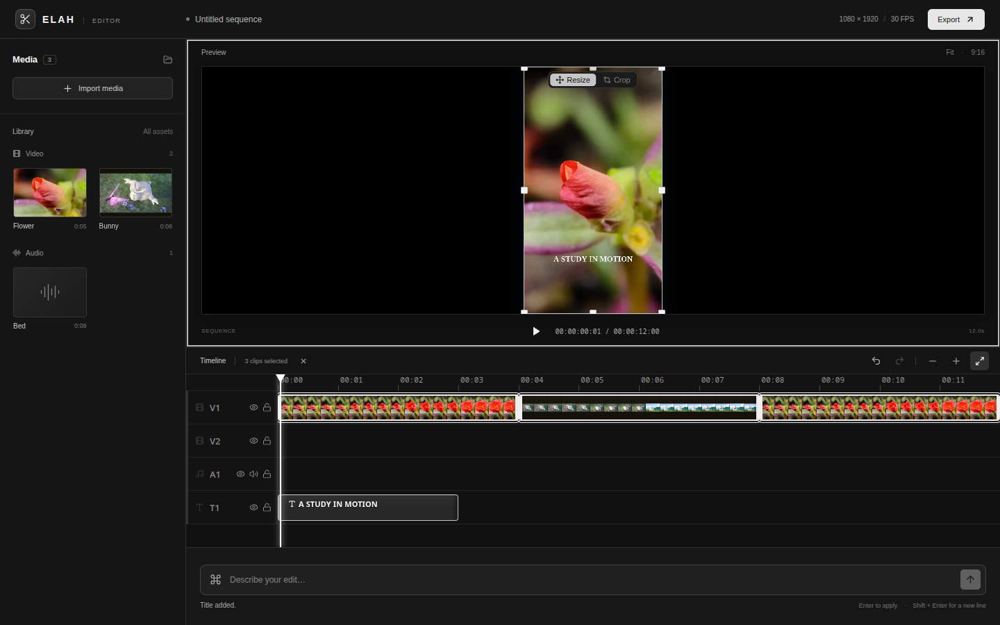
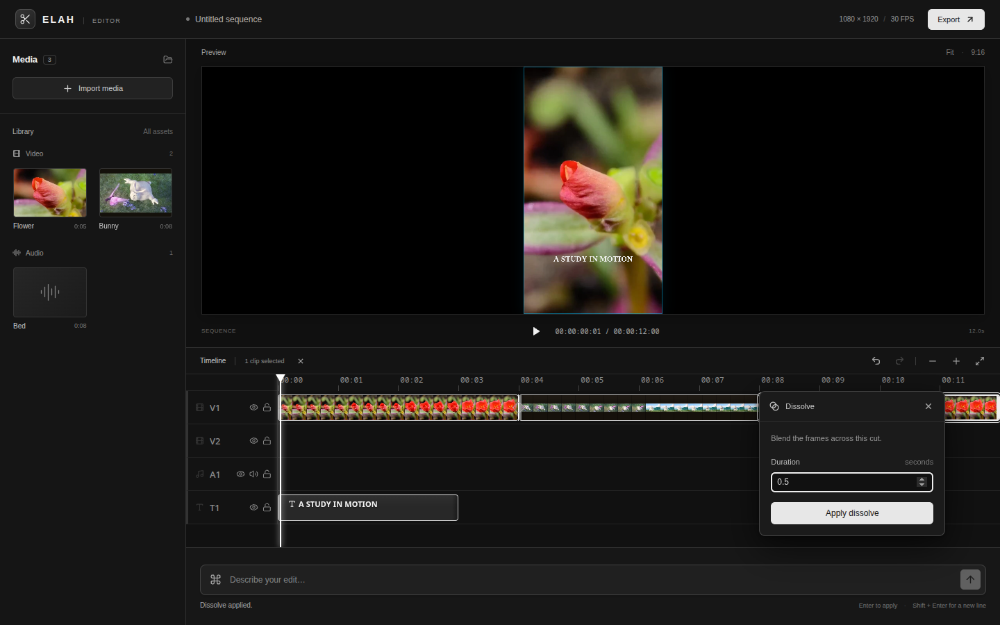

# Editor UI: issues #12–#14

The editor now uses a shared monochrome system across its application bar,
media library, Preview, transport, timeline, command field and floating controls.
The previous layout had disconnected controls, horizontally scrolling media
cards and menus positioned using estimated dimensions. The revised layout
groups imports in the library, export in the application bar, playback below
Preview, and history/zoom controls above the timeline. Empty and loading states
use the same typography and surfaces. The command field remains the only agent
input.

## Floating controls

Clip controls open by right-click or double-click. Clip controls and dissolve
controls render in a body portal, measure their actual size, flip at viewport
edges and shift inside a 10px inset. They update after resize and scroll, and
limit their size to the visible viewport. Escape works while an input is focused;
clicking outside dismisses the panel. The SDK's crop/resize toolbar stays inside
Preview instead of being clipped above it.

## Selection boundary

Shift, Cmd or Ctrl-click toggles clips in Elah's existing selection store. Selected
clips have white outlines, a subtle tint and edge handles; the timeline toolbar
shows a count and a clear-selection action. Selection survives scrubbing,
zooming and fitting. Modifier-click selects without starting a drag.

`getSelectedClipIds(engine)` in `src/host/selection.ts` returns selected clip ids
that still exist in the project. This is the host boundary for future command
context. This change does not send selection to the planner or change agent ops.

## Verification

- `npm run build`
- `npx oxlint src tests`
- `python3 -m unittest discover -s sense -p 'test_*.py'`
- With Vite running: `CHROME_PATH=/path/to/chrome node tests/ui.mjs`
- With Vite running: `CHROME_PATH=/path/to/chrome node tests/browser.mjs`

Omit `CHROME_PATH` when Playwright's Chromium is installed. The UI checks use
mock command responses and bundled sample media; no cloud model or vault is
required. They cover multi-selection, zoom and scrubbing, scrolled menus,
Escape/click-outside dismissal, dissolve controls, crop/resize toolbar bounds,
viewport resizing and horizontal overflow at laptop and mobile sizes.

The repository-wide `npm run lint` also scans the vendored `.agents` kit and
currently reports a pre-existing hooks error in
`.agents/skills/poteto-mode/scripts/orch/orch.test.ts:54`. Application and test
lint passes independently.

Issue #10 (agent rotation) remains in the cloud agent's lane. No planner,
credentials, embedding paths or agent operation implementation changed here.
